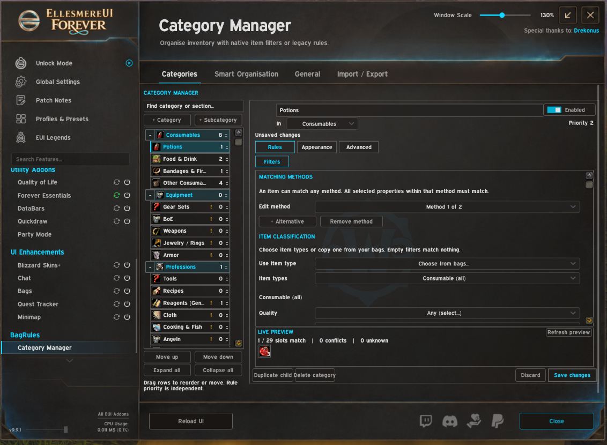
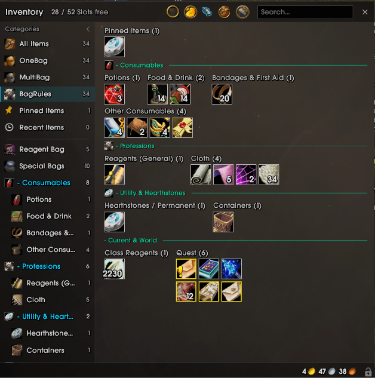
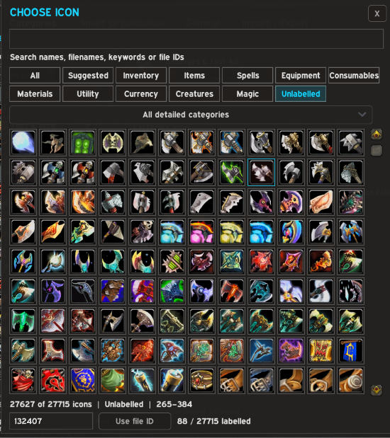

# BagRules

> **Alpha software:** BagRules is under active development. Features, interfaces, compatibility, and data formats may change between releases.

**Your bags. Your categories. Your rules.**

BagRules is an advanced inventory management addon for World of Warcraft, developed as part of **EllesmereUI (EUI)**. It gives players greater control over how items are categorized, organized, and displayed through customizable categories, subcategories, rule-based organization, and intelligent icon selection.

Designed for flexibility and integration with the native inventory experience, BagRules lets players build an inventory hierarchy that suits their playstyle.

## Screenshots

See the [BagRules screenshot gallery](SCREENSHOTS.md) for the category manager, hierarchical bag view, and searchable icon browser.

### Category manager

### Hierarchical inventory

### Icon browser

## Features

### Custom inventory organization

- Create custom categories and subcategories.
- Organize items using configurable rules.
- Select parent categories to display all associated subcategories, or browse individual subcategories.
- Customize category and subcategory names and icons.
- Register native virtual bag categories using a hierarchical structure.

### Advanced icon browser

- Browse an extensive collection of World of Warcraft icons.
- Search across the entire icon database.
- Explore thematic icon categories.
- Scroll continuously through available icons without pagination.
- Assign icons to individual categories and subcategories.
- Receive intelligent icon suggestions based on category names.

### Configuration and integration

- Centralized configuration interface.
- Flexible rule-based inventory organization.
- Integration with native bag categories.
- Designed as part of the EllesmereUI (EUI) ecosystem.

## Installation

1. Download the latest available release ZIP from GitHub Releases.
2. Extract the archive.
3. Copy the `BagRules` folder into your World of Warcraft `Interface/AddOns` directory.
4. Restart World of Warcraft or reload the user interface using `/reload`.
5. Ensure BagRules is enabled in the AddOns menu.

## Compatibility

BagRules is currently being developed for **WoW Forever** as part of EllesmereUI (EUI).

Compatibility with other World of Warcraft clients and versions has not yet been verified. Consult the release notes for version-specific requirements and dependencies.

## Development status

BagRules is under active development. Features, interfaces, and functionality may change between releases.

The project focuses on customization, usability, performance, and integration with the existing inventory experience.

## Roadmap

- [ ] Expand inventory rule options.
- [ ] Improve automatic item categorization.
- [ ] Expand icon metadata and searchable labels.
- [ ] Improve intelligent icon recommendations.
- [ ] Add category and rule import/export.
- [ ] Introduce shareable configuration profiles.
- [ ] Optimize inventory processing and performance.
- [ ] Evaluate compatibility with other inventory addons.
- [ ] Introduce automated release packaging.

## Bug reports and feature requests

Use GitHub Issues to report bugs, suggest improvements, or request new features.

When reporting a bug, include:

- BagRules version.
- World of Warcraft client version.
- EllesmereUI version, if applicable.
- Description of the issue.
- Steps to reproduce the issue.
- Lua error messages, if available.
- Screenshots, where applicable.

## Contributing

Feedback, suggestions, and contributions are welcome. Please open an issue to discuss significant changes before submitting a pull request.

## License

Project licensing is pending final review. Third-party code, dependencies, and icon metadata remain subject to their respective licenses and terms.

World of Warcraft and its associated assets are the property of Blizzard Entertainment. BagRules is an independent community project and is not affiliated with or endorsed by Blizzard Entertainment.

---

**BagRules — Inventory organization without unnecessary limitations.**

*Part of EllesmereUI (EUI).*
