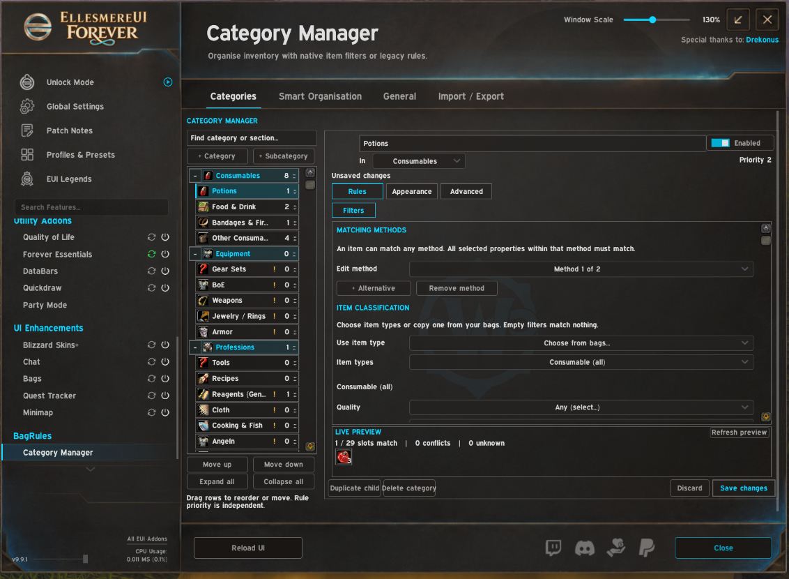
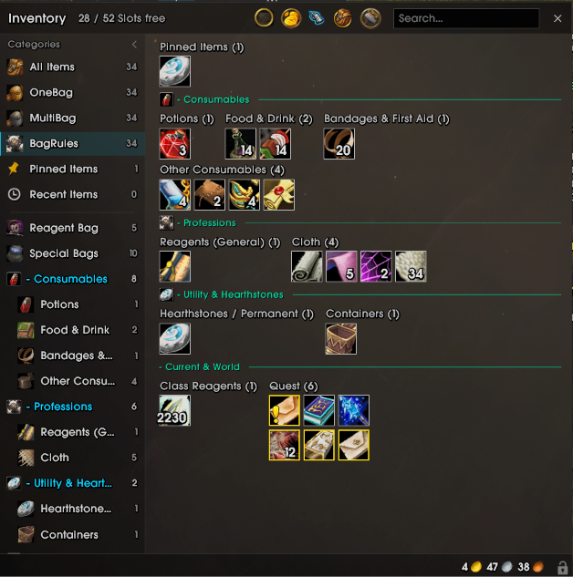
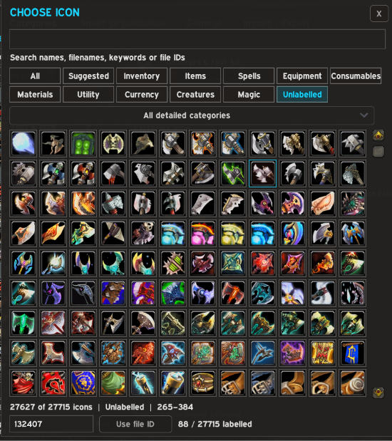

# BagRules screenshots

These screenshots show the intended BagRules experience inside EllesmereUI: hierarchical bag categories, the category manager, native filters, live preview, and the icon browser.

> These images were captured from later development builds and may show functionality newer than the currently checked-in 0.4.0-alpha source. See the repository documentation for exact implementation and verification status.

## Category manager

The EllesmereUI-integrated manager provides parent categories, subcategories, native matching methods, appearance controls, advanced options, and a live preview.

## Bag hierarchy

BagRules groups inventory items into selectable parent categories and subcategories while retaining the native EllesmereUI bag layout.

## Icon browser

The icon browser supports search, thematic filters, detailed categories, file IDs, and continuous browsing across discovered client icons.

